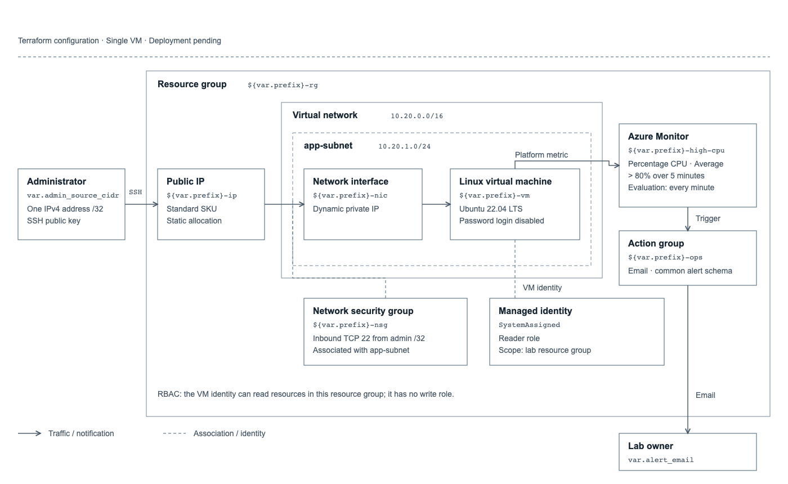

<div align="center">

# Azure Enterprise Infrastructure

**Infrastructure as code · Secure administration · Identity · Observability**

A reproducible Azure engineering lab built with Terraform, Ubuntu, and GitHub Actions.

[Explore the project](azure-enterprise-infrastructure/README.md) · [Deployment runbook](azure-enterprise-infrastructure/docs/deployment-runbook.md) · [Testing & evidence](azure-enterprise-infrastructure/TESTING.md)

</div>

## Infrastructure topology



[View full-size diagram](azure-enterprise-infrastructure/docs/images/architecture.svg)

SSH access follows the administrator → Standard public IP → network interface → Ubuntu VM path. The diagram shows resource boundaries, the subnet NSG association, resource-group Reader access, and the CPU alert email flow. Solid arrows show traffic or notifications; dashed lines show associations or identity relationships.

> **Project status:** Local Terraform validation and four security tests passed. Live Azure deployment, alert delivery, screenshots, and recovery evidence are pending.

## Built to demonstrate

| Networking & compute | Identity & security | Monitoring & automation |
| --- | --- | --- |
| Dedicated VNet and workload subnet | SSH restricted to one IPv4 `/32` | CPU metric alert with email notifications |
| Ubuntu VM with a Standard public IP | Key-based authentication | GitHub Actions formatting and validation |
| Subnet network security group | Managed identity with scoped Reader RBAC | Four mock security tests and repeatable scripts |

## Get started

Install Azure CLI and Terraform 1.9 or newer (below 2.0), then follow the [deployment runbook](azure-enterprise-infrastructure/docs/deployment-runbook.md) for permissions and subscription setup.

```bash
cd azure-enterprise-infrastructure
az login
az account set --subscription YOUR_SUBSCRIPTION_ID
cp terraform/terraform.tfvars.example terraform/terraform.tfvars
# Fill in your subscription, public IPv4 /32, SSH public key, and alert email.
bash scripts/preflight.sh
```

The script validates the configuration and creates a deployment plan. Review the plan before applying; full deployment, live validation, and cleanup commands are in the [project guide](azure-enterprise-infrastructure/README.md).

## Explore the repository

| Location | What you’ll find |
| --- | --- |
| [Terraform](azure-enterprise-infrastructure/terraform/) | Azure resources, inputs, outputs, provider lock file, and security tests |
| [Scripts](azure-enterprise-infrastructure/scripts/) | Deployment preflight and live infrastructure checks |
| [Infrastructure diagram](azure-enterprise-infrastructure/docs/images/architecture.svg) | Resource boundaries, SSH access, managed identity, and CPU alert notifications |
| [Documentation](azure-enterprise-infrastructure/docs/) | Deployment runbook, local validation results, and evidence tracker |
| [Testing guide](azure-enterprise-infrastructure/TESTING.md) | Connectivity checks, CPU alert exercise, and recovery validation |
| [GitHub Actions](.github/workflows/terraform.yml) | Automated formatting, validation, and mock tests |

## Engineering evidence

[Local validation results](azure-enterprise-infrastructure/docs/local-validation.md) record completed checks. The [evidence checklist](azure-enterprise-infrastructure/docs/EVIDENCE.md) tracks live deployment proof, and the [incident report](azure-enterprise-infrastructure/docs/incident-report.md) is ready for a real reproduced failure and resolution.

This is a single-VM lab. High availability, backups, and centralized guest logs are outside its current scope. State, credentials, and local deployment settings are excluded from Git; preserve state securely until teardown.
