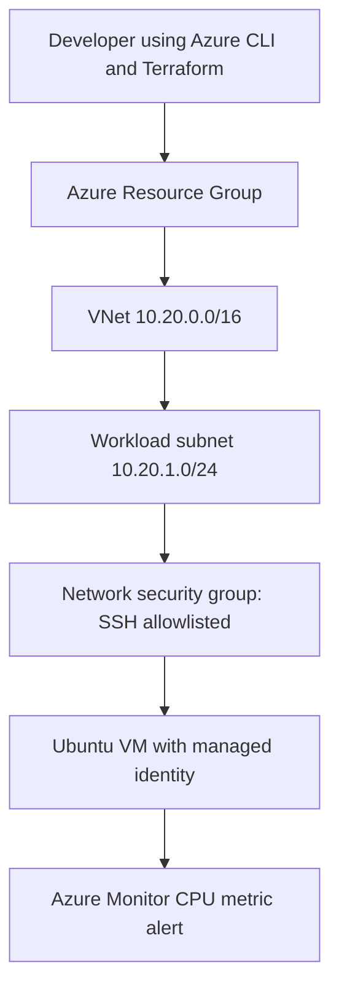

# Azure Enterprise Infrastructure Lab

Terraform provisioning of an Azure Linux VM in a dedicated virtual network with SSH restricted to a chosen CIDR, managed identity, RBAC-ready architecture and a CPU metric alert.

# Portfolio status

**Status: starter implementation; deployment has not been performed or verified.** Code, examples, and tests are supplied. Do not describe the infrastructure as deployed, tested in Azure, or production-ready until you personally complete and record the validation steps.

**Security:** Use your own sandbox subscription/tenant and synthetic data. Never upload secrets, Terraform state, access tokens, or employer data. Check cloud charges and clean up resources after demonstrations.

## Architecture



## Prerequisites
- Azure subscription, Azure CLI, Terraform >= 1.6 and an SSH public key.
- Azure CLI logged in (`az login`) and a selected subscription (`az account set --subscription ...`).
- You accept potential VM/public IPv4/monitoring costs. SSH is restricted to your specified public IP; **never use 0.0.0.0/0** for `admin_source_cidr`.

## Deploy
```bash
cd terraform
cp terraform.tfvars.example terraform.tfvars
# Replace values: subscription_id, admin_source_cidr (YOUR_IP/32), ssh_public_key
terraform init
terraform fmt -check
terraform validate
terraform plan -out=tfplan
terraform apply tfplan
terraform output
```

## Validate and collect proof
1. Save redacted `terraform plan` output and `terraform output` showing infrastructure resources.
2. Confirm access from your allowed source IP via `ssh -i ~/.ssh/id_ed25519 azureuser@<vm_public_ip>`.
3. Inspect NSG inbound rules; verify SSH is NOT open to the entire internet.
4. In Azure Monitor, locate the CPU alert; generate controlled load and document observed behavior if you test firing.
5. Screenshot VNet/subnets, VM, NSG, alert and the successful CI workflow (redact identifiers).
6. Record a short demo and write a real issue and resolution in `docs/incident-report.md`.
7. `terraform destroy` after collecting evidence. **Always confirm clean-up and billing.**

## Automated checks
GitHub Actions runs Terraform formatting and validate only. These checks do **not** deploy to Azure or prove live operation.

## Resume claim (after verification)
> Built a Terraform-provisioned Azure VM lab with segmented networking, restricted SSH access, managed identity, and an Azure Monitor metric alert; documented deployment and teardown.

See `docs/EVIDENCE.md` for the honest proof checklist.
