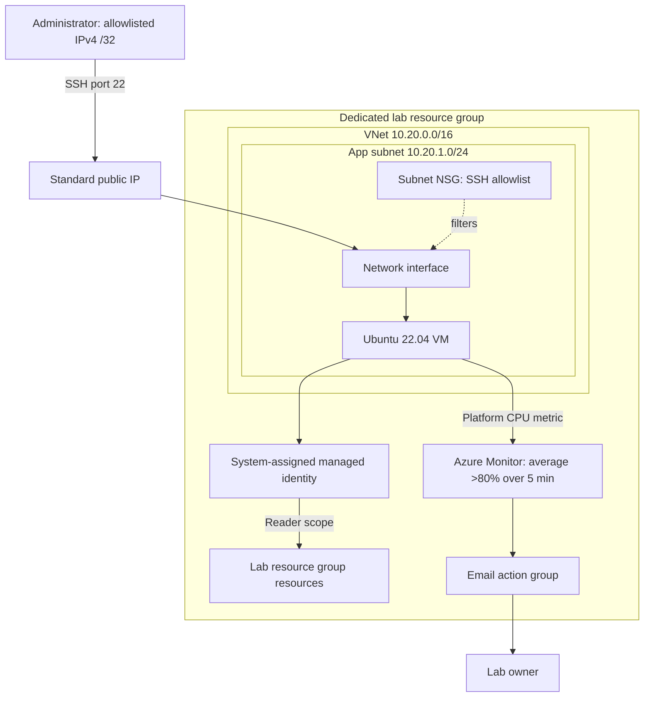

# Azure Enterprise Infrastructure Lab

A reproducible Azure administration lab for demonstrating networking, identity, monitoring, and troubleshooting. Terraform provisions an Ubuntu VM with SSH restricted to one IPv4 address, a system-assigned managed identity with resource-group Reader access, and a CPU alert connected to an email action group.

**Status:** deployment configuration and local automated checks are complete. Azure deployment, connectivity, alert delivery, screenshots, and incident evidence are pending. This is a single-VM learning environment; availability, backups, and centralized guest logging are outside its scope.

## Architecture



## Reproduce

Install Terraform >=1.9 and <2.0, Azure CLI, and an SSH client. Use a sandbox subscription and an SSH public key. You need resource provisioning and role assignment permissions. The [deployment runbook](docs/deployment-runbook.md) covers prerequisites, state handling, failure recovery, and teardown.

From the repository root:

```sh
cd azure-enterprise-infrastructure
az login
az account set --subscription YOUR_SUBSCRIPTION_ID
cp terraform/terraform.tfvars.example terraform/terraform.tfvars
# Edit subscription_id, admin_source_cidr (YOUR_PUBLIC_IPV4/32),
# ssh_public_key (contents of your .pub file), and alert_email.
bash scripts/preflight.sh
cd terraform
# Inspect tfplan and verify the target subscription before applying.
terraform apply tfplan
cd ..
bash scripts/validate-live.sh
```

The preflight script runs formatting, validation, security tests, and a real Azure plan. It never applies automatically. Review expected VM, public IP, disk, and monitoring charges before deployment. Verify SSH host keys through a trusted channel and use the private key matching your configured public key.

## Security and automation

Passwords are disabled. The subnet NSG explicitly permits SSH only from your `/32`; Azure's default VNet rules still apply. The managed identity receives Reader access in the lab resource group. A notification action makes the CPU alert usable; verify email delivery separately.

The root [GitHub Actions workflow](../.github/workflows/terraform.yml) checks formatting, provider validation, and mock security tests without Azure credentials. The committed provider lock file fixes provider selection. Mock testing uses Terraform's [official provider mocking support](https://developer.hashicorp.com/terraform/language/tests/mocking).

State, local variables, plans, private keys, and raw evidence are gitignored. Never upload credentials, employer information, or unredacted state. Keep local state securely until teardown.

## Testing and evidence

See [TESTING.md](TESTING.md) for offline and live checks, a bounded CPU alert exercise, and negative SSH testing. Capture actual results in [docs/EVIDENCE.md](docs/EVIDENCE.md) and a reproduced issue in [docs/incident-report.md](docs/incident-report.md). Local check results are recorded in [docs/local-validation.md](docs/local-validation.md). Screenshots and demonstration recordings must come from a real deployment.

## Teardown

```sh
cd terraform
terraform plan -destroy -out=destroy.tfplan
terraform apply destroy.tfplan
az group exists --subscription YOUR_SUBSCRIPTION_ID --name YOUR_PREFIX-rg
```

The last command should return `false`. Check billing and any resources created outside Terraform as well.

## Results and lessons

Local validation proves the configuration matches the installed provider schema and checks intended security settings. It does not establish Azure policy compatibility, regional capacity, reachability, or alert delivery. Live outcomes remain pending. Requiring an email destination, assigning a scoped role to the identity, and testing rejected SSH ranges address gaps in the starter configuration.

Only after collecting deployment evidence, a suitable resume statement is: “Built a Terraform-provisioned Azure VM lab with restricted SSH, scoped managed-identity RBAC, and CPU notifications; documented deployment, validation, and teardown.”
